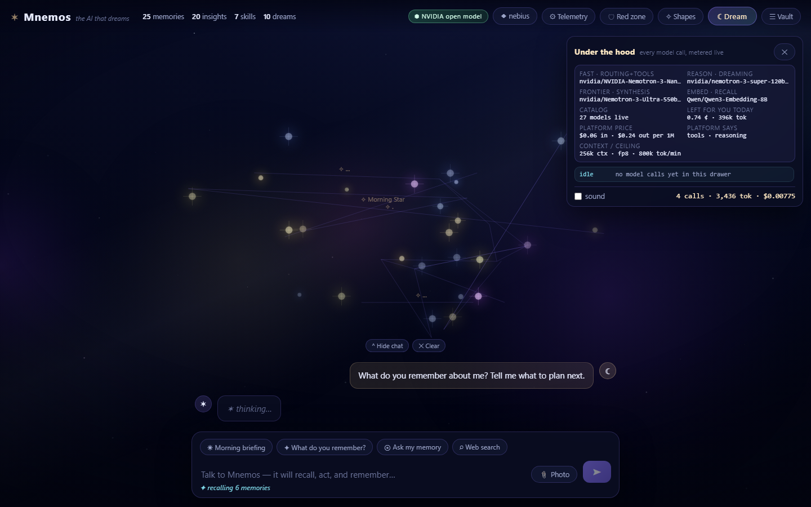

<div align="center">

# ✶ Mnemos

### Memory you can see, question, and own.

**Nebius × NVIDIA Global AI Hackathon · Personal AI track · Team Softmatter Labs**

🧭 [Review it in 60 seconds](https://mnemos-personal-ai.onrender.com/?review=1) ·
▶ [Live demo](https://mnemos-personal-ai.onrender.com) ·
[3-minute video](https://youtu.be/7Cq7HQzpTZQ) ·
[Feedback on the platform](FEEDBACK.md)

`Nebius Token Factory` · `NVIDIA Nemotron 3 Nano/Super/Ultra/Super-VL` · `Tavily` · MIT · 42 tests



</div>

---

Every AI assistant you use either forgets you when the tab closes, or remembers you in a
box you cannot open. Mnemos is a private, always-on personal AI whose memory is a **sky
you can watch**: each memory is a star, brighter while it is being used, dimming as it
fades. It cites the exact memories behind each answer, you can **delete one memory and
watch the answer change**, it consolidates overnight into insights and a morning brief,
and the whole vault is one readable JSON file that you can export or burn.

Three beats, in the order you should try them:

| | | |
|---|---|---|
| **Watch it think** | Ask a question and see the retrieval happen: the stars it reads pulse, the tool calls stream by (`memory_search`, `web_search`, `sky_shape`…), and the answer arrives with `[M…]` citation chips. Click one and that exact star flares. A citation that cannot be resolved renders **red** — you see the model overreach instead of trusting it. And because models are not perfectly disciplined about receipts, the app audits its own: a memory that overlaps the answer but was never cited appears as a dashed amber *matched but not cited* chip, so an uncited claim is still traceable. The **⚙ Telemetry** drawer shows the model, tier, tokens, KV-cache hits, latency and USD of every call, with prices read live from the platform. |
| **Test it** | Click any star → **"🧪 What if it forgot this?"** Mnemos answers the same question twice, once with that memory and once without, diffs the two sentences, counts the citations it lost, and scores whether the memory was load-bearing. Trust is not a claim here; it is an experiment you can run in four seconds. |
| **Own it** | Export your vault, import it into a local install, or burn it. Attach a whiteboard photo and an NVIDIA vision model reads it into new stars. Ask for a dream with an intention — *"10K race in six weeks, portfolio review Friday"* — and you wake up to a brief with three concrete actions, written from insights your own notes never stated out loud. |

---

## Review it in 60 seconds — nobody needs to narrate this

A judge should not need a walkthrough, so the demo gives one itself. Open
[`/?review=1`](https://mnemos-personal-ai.onrender.com/?review=1) and a five-step rail is
already waiting: each step says what to look for *before* you click it, every prompt is
hard-coded into the app (nothing arrives from the URL, so a shared link cannot inject a
question into somebody else's vault), and it runs against the real models.

| | what you are checking |
|---|---|
| **1 · Ask it what it remembers** | retrieval is visible: the stars it reads pulse, the tool calls stream past, the answer arrives with `[M…]` chips |
| **2 · Click a citation** | that exact star flares. A chip that cannot resolve renders **red**; a memory it used without citing shows up as a dashed *matched but not cited* row — the app auditing its own model |
| **3 · "What if it forgot this?"** | the same question answered with that memory and without it, diffed and scored. Trust here is an experiment, not a claim |
| **4 · ⚙ Telemetry** | model, tier, tokens, cache hits, latency and USD for every call, priced live from Token Factory |
| **5 · ☰ Vault** | it is *your* copy: one vault per visitor, plain JSON, exportable, burnable, expiring — the tag in the top bar names it |

**Impact, as one true story.** Its author has used it daily since 18 Oct as the checking tool
on his own claims ([docs/DIARY.md](docs/DIARY.md)). On day 3 it asserted a confident rule
about vault expiry that was flatly wrong — and the chips it cited pointed at memories that did
not exist. Because every claim carried a receipt, the false belief was traceable to the star
it came from, and the write path was fixed the same evening (`19ed0ce`, `e1421a5`, `f6480d3`)
and re-probed on the live demo. That is the use case: not *it remembers*, but **a wrong belief
becomes visible, and you can delete it.**

**One platform used deeply, not five used wide.** Every model call in the app goes to Nebius
Token Factory: one OpenAI-compatible endpoint, four NVIDIA Nemotron 3 models chosen by their
own advertised `supported_features`, `Qwen3-Embedding-8B` for recall, Tavily for the outward
dream. The server has **zero runtime dependencies** — plain Node, no SDK, no framework.

**Accessibility, stated so you can check it.** `prefers-reduced-motion` is honoured twice over
(the canvas stops drifting *and* CSS animations are damped), every control is a real `<button>`
reachable by keyboard, `Esc` closes what `Esc` should close, the transcript and the status
ticker are `aria-live` regions, and no state is carried by colour alone — an uncited chip
differs in *border style*, not just hue.

---

## Does it meet the rules? (checked, not asserted)
| Requirement | Where it is true |
|---|---|
| Runs on Nebius Token Factory | every turn, every dream, every embedding is a runtime call to `https://api.tokenfactory.nebius.com/v1`. The UI's **⚙ Under the hood** drawer shows the model, tier, tokens, latency and USD for each live call. |
| ≥1 NVIDIA open-source model | four: `nvidia/NVIDIA-Nemotron-3-Nano-30B-A3B` (fast tier), `nvidia/nemotron-3-super-120b-a12b` (reasoning), `nvidia/Nemotron-3-Ultra-550b-a55b` (frontier: dream synthesis + morning brief), `nvidia/Nemotron-3.5-Super-VL` (photo → memory). |
| Personal AI track | persistent memory + reusable skills (`SKILL.md`) + your choice of tools + tasks across daily workflows + data under your control, and it uses the named toolchain: MCP memory server for **NVIDIA Hermes / NemoClaw** hosts, plus an **OpenShell** default-deny policy in [`deploy/openshell/`](deploy/openshell/README.md). |
| Working demo URL | [mnemos-personal-ai.onrender.com](https://mnemos-personal-ai.onrender.com) — for a first look use [`/?review=1`](https://mnemos-personal-ai.onrender.com/?review=1), the guided path above. (Free tier; a keep-alive cron usually keeps it warm — measured 0.30 s on 2026-10-20, but 22.8 s after a cold boot on 2026-10-19 — and every restart re-seeds the sandbox vault, because Render free has no disk.) |
| Public repo + open-source licence | MIT, visible in the repo's About panel. |
| Best Use of Tavily | `web.search` is a native agent tool **and** the Dream Engine's world model ("outward dream": tonight's replay turns one memory into a query, searches, and wakes with new stars). Runtime calls, not a mention. |
| New in the Submission Period | first commit **6 October 2026** — inside the window. Nothing predates it. |
| Feedback | [FEEDBACK.md](FEEDBACK.md), with repro commands and two findings you can reproduce in a minute. |

## How it works

```
 Browser (galaxy canvas · chat · ablation · under-the-hood)
     │  SSE + cookie session                    ┌──────────────────────────────┐
     ▼                                          │ MCP clients: Hermes Agent,   │
 Gateway ── per-visitor vault ──► Store (JSON)  │ Claude Code, any MCP host    │
     │        one directory each                └──────────────┬───────────────┘
     ├── Write path   Nano extracts durable facts → dedupe → embed → star is born
     ├── Read path    BM25 ⊕ cosine (hybrid fusion) → top-k → native tool_calls → cited answer
     ├── Dream path   replay (biased by your intention) → Ultra insights → constellation →
     │                SKILL.md → morning brief → 21-day half-life decay
     └── Outward path Tavily query → new stars from the wider world
```

**Model routing is capability-gated, not guessed.** On boot the app reads
`GET /v1/models?verbose=true`, checks each model's `supported_features`, and only offers
native tool schemas when the platform says the model has them. If an ID stops resolving,
it is healed to a live one automatically — we learned that the hard way when Nebius
retired a model mid-hackathon and took our own demo down.

| Tier | Model | Used for | Published price / 1M |
|---|---|---|---|
| fast | Nemotron 3 Nano 30B-A3B | routing, tools, extraction, answers | $0.06 / $0.24 |
| reason | Nemotron 3 Super 120B-A12B | dream consolidation | $0.30 / $0.90 |
| frontier | Nemotron 3 Ultra 550B-A55B | one deep-thought pass + morning brief per dream | $1.00 / $3.00 |
| vision | Nemotron 3.5 Super-VL | photos and screenshots → memories | $0.30 / $0.90 |
| embed | Qwen3-Embedding-8B (4096-d → 256) | semantic recall | $0.01 / — |

Measured on our own account: **a chat turn with a web-search tool call ≈ $0.0004**,
**a full dream ≈ $0.012**, **a whiteboard read ≈ $0.00018**. Every visitor is capped
(per-IP, per-session and per-host) and can see their remaining budget in the drawer.

## Retrieval, measured

`eval/` holds a reproducible benchmark: **59 seeded memories across 9 sessions** and
**40 questions** built on the **LongMemEval** ability taxonomy (arXiv:2410.10813) —
single-session, multi-hop, temporal, **knowledge-update** (a fact changes and the new
value must win) and **abstention** (the answer is not in the vault, so the system must
say so). Every arm is scored for retrieval quality, answer correctness against an oracle,
citation validity, staleness, latency and spend, using the real provider.

Two independent live runs of the same shipped code, `nvidia/NVIDIA-Nemotron-3-Nano-30B-A3B`
+ `Qwen/Qwen3-Embedding-8B`, k=6, re-run on 21 October after the diary found the model
answering from recalled memories **without emitting a single citation chip** — so the chip
instruction got stricter. Retrieval metrics are deterministic and identical across
runs; answer-side metrics are shown as the range the two runs produced, because the model is
sampled and pretending otherwise would be fake precision:

| Arm | hit@6 | recall@6 | MRR | answer acc | stale answer | citations resolve | abstains | $ / 100 q |
|---|---|---|---|---|---|---|---|---|
| lexical only | 97.0% | 94.4% | 0.737 | 75.8–81.8% | 11.1% | 88.2–100.0% | 71.4–85.7% | $0.0024–0.0025 |
| embedding only | 100.0% | 94.4% | **0.909** | 78.8–81.8% | 33.3–55.6% | 86.5–91.7% | 42.9% | $0.0029 |
| **hybrid (shipped)** | 97.0% | 92.9% | 0.824 | 72.7–81.8% | 0.0–11.1% | 88.6–88.9% | 42.9–57.1% | $0.0028–0.0029 |
| full agent loop | 97.0% | 92.9% | 0.824 | 63.6–66.7% | 11.1% | 37.5% | 0% | $0.0121–0.0122 |

The stricter instruction did what it was meant to: citations resolving in the agent loop went
from 17.5–35.0% to **37.5% in both runs**, and the loop's answers now resolve every chip they
carry. What that bought in accuracy is nothing — the loop is still the least careful arm we
ship, which is the point of publishing it.

**What the numbers made us fix.** The first live run reported that the system answered
unanswerable questions almost every time, which flatly contradicted our own
anti-hallucination claim. Reading the model's actual output instead of trusting the metric
found two separate causes:

1. `recall()` returned *the six most recent memories* whenever nothing matched — an
   invitation to confabulate. It now has a relevance floor and returns nothing, and the agent
   is told when retrieval is weak instead of being handed padding.
2. The abstention detector only matched contracted English, so "**I do not remember**" was
   being scored as a hallucination. A measurement bug, fixed and re-run.

After both, the shipped arm abstains on 43–57% of unanswerable questions (up from 0–43%
before, where part of that gap was the detector itself), and marking a replaced memory
`supersededBy` and dimming it holds stale-fact assertions to 0–11% on the shipped arm.

**What is still weak, stated plainly.** The full agent-loop arm abstains 0% of the time and
only 37.5% of its citations resolve against the *initial* recall set — because in a tool loop
the agent legitimately retrieves more memories mid-turn, which this scorer does not credit,
and because its conversational system prompt is less strict about declining than the
direct-answer arms. Both are real: the loop is more useful and less careful than the
single-shot path. Tightening it is the top item after the hackathon.

```bash
node eval/build-vault.mjs          # deterministic vault + 40 questions
node eval/run.mjs --mode mock      # prove the harness offline, spends nothing
node eval/run.mjs --mode live --yes --budget 1.50
node eval/report.mjs               # eval/results/table.md + chart.html
```

Scope, honestly: this is a *LongMemEval-style protocol on a 40-question in-house set*. It is
not score-comparable with published LongMemEval numbers. Full definitions in
[`eval/README.md`](eval/README.md); raw rows in `eval/results/live.json`.

## Portability: your memory is not trapped in this app

`src/mcp.js` is a **zero-dependency MCP server** (newline-delimited JSON-RPC over stdio,
protocol negotiated from 2025-03-26 to 2025-06-18, stdout is protocol-only). Eight tools —
`memory_search`, `memory_remember`, `memory_forget`, `memory_list`, `vault_snapshot`,
`dream_run`, `skill_export`, `sky_shape` — and resources `mnemos://vault/{stars,timeline,skills}`
plus a per-memory template. Point any MCP host at your vault:

```bash
node src/mcp.js --vault ./vault            # stdio
# Hermes Agent / Claude Code config: see mcp.example.json
```

Skills that Mnemos learns while dreaming export as **`SKILL.md`** files — the same
convention NVIDIA's Hermes/NemoClaw self-evolving agents use — so a second agent can pick
up a routine your memory engine figured out. That is the portability claim, and it is
testable: `node --test test/mcp.test.js` drives the server as a real subprocess.

## Privacy as architecture, not as a promise

* **One vault per visitor.** Cookie-scoped directory, no shared index, no cross-session
  recall, nothing persisted for a visitor that is creating vaults too fast. Idle vaults
  expire. Verified: a fact stored by visitor A is absent from visitor B's retrieval.
* **Your data leaves the browser only to two hosts** — Token Factory and Tavily. Inside an
  [OpenShell](deploy/openshell/README.md) sandbox that becomes kernel-enforced default-deny.
* **Red zone**: name topics the assistant must never discuss; the list is injected
  server-side, so it is not something a user can prompt out of it.
* **Receipts, audited**: cited chips, dashed *matched but not cited* chips, and red
  unresolvable chips are three different states on purpose. The system never upgrades a
  guess into a citation.
* **Anti-injection plumbing**: input wrapping, secret protocol in a separate system block,
  SSRF guard on `web.fetch`, 100 KB body cap, images accepted only as data URLs.
* **No accounts, no telemetry, no analytics script.** The drawer's numbers come from the
  provider's own usage fields.

## Try it without typing anything

The demo accepts deep links, so a judge (or a screen recording) can open it already in
motion. No text is taken from the URL — the four prompts are hard-coded, so a shared link
cannot inject a question into somebody else's sandbox.

| Link | What you see |
|---|---|
| `?review=1` | the five-step review rail, open and waiting — the path described above |
| `?demo=1#telemetry` | a real turn in flight with the telemetry drawer open |
| `?demo=2` | the agent calling Tavily mid-answer and citing the result |
| `?demo=1&ablate=1` | the ablation experiment on the first cited memory |
| `?demo=3` | "arrange my sky like Leo" — the agent reshapes the galaxy itself |
| `?dream=1` | the dream overlay: replay → insights → constellation → brief |

## Run it

Requires Node ≥ 20. No `npm install` for the app itself — runtime dependencies: zero.

```bash
cp .env.example .env        # add NEBIUS_API_KEY (and optionally TAVILY_API_KEY)
npm start                   # → http://localhost:8787
```

$25 of free Token Factory credit is available for this hackathon with activation code
`NEBIUS-DEVPOST-GLOBAL26`; Tavily credits via `BBDEVPOST`. With no key at all the app still
runs: the galaxy, decay, timeline, vault tools and dream replay all work, and generation
degrades politely.

| Env | Default | Notes |
|---|---|---|
| `NEBIUS_API_KEY` | — | the only required key |
| `NEBIUS_MODEL` / `_REASONING_MODEL` / `_FRONTIER_MODEL` / `_VISION_MODEL` / `_EMBEDDING_MODEL` | catalog-derived | healed against `/v1/models?verbose=true` on boot |
| `TAVILY_API_KEY` | empty | enables `web.search` + outward dreams |
| `MNEMOS_SINGLE_VAULT=1` | off | owner mode: one local vault (your own machine) instead of per-visitor sandboxes |
| `GATE_TURNS_PER_MIN` / `GATE_TURNS_PER_HOUR` / `GATE_TOKENS_PER_DAY` / `GATE_USD_PER_SESSION` / `GATE_USD_HOST` | 6 / 30 / 400k / $0.75 / $8 | spend ceilings for a public demo |
| `VAULT_TTL_DAYS` | 45 | sandbox vaults expire |

```bash
npm test            # 42 tests: store, decay, citations, hybrid recall, agent loop,
                    # SSRF guard, dream engine, nightly catch-up, MCP protocol
npm run typecheck                   # strict JS type-check over src/, public/, eval/, test/
npm run eval                        # the live benchmark (spends ~$0.01, asks for --yes)
npm run eval:mock                   # the same harness offline, spends nothing
npm run doctor                      # vault audit: embedding coverage, dupes, contradictions,
                                    # staleness, secret leakage, red-zone overshoot
```

## Repo map

```
src/llm.js        provider chain, catalog self-heal + capability map, tiered routing,
                  native tool calls, vision calls, cost meter, 429 back-off
src/brain.js      agent loop (native tool_calls with prose fallback), hybrid recall,
                  citation extraction, photo reading, memory extraction, red zone, SSRF guard
src/store.js      vault schema, Okapi BM25, hybrid fusion, 21-day decay, reinforce, layout, brief
src/dream.js      replay → outward Tavily web-dream → Ultra consolidation → constellation
                  naming → SKILL.md → intention-conditioned morning brief → decay
src/sessions.js   per-visitor vault directories, export/import/burn, TTL sweep
src/limits.js     three-layer spend gate
src/ablation.js   answer-with / answer-without, word diff, impact verdict
src/mcp.js        zero-dependency MCP server (stdio)
src/server.js     HTTP gateway, SSE, cookies, budget, telemetry endpoints
src/night.js      03:30 nightly dream + catch-up on boot
public/           galaxy renderer, chat, ablation card, under-the-hood drawer, tour, sound
eval/             LongMemEval-style benchmark harness + dataset + results
deploy/           OpenShell policy + Nebius Jobs notes (honest, verified-or-labelled)
test/             42 tests · tools/vault-doctor.js · .github/workflows/keep-alive.yml
```

## The pitch in three minutes

Video: *link goes here* — 0:00 the sky, 0:25 citations that flare, 0:55 **the ablation**,
1:25 a dream with an intention and the morning brief, 2:05 Hermes/Claude reading the vault
over MCP, 2:35 the measured retrieval chart, 2:50 "Nebius Token Factory, NVIDIA Nemotron 3."

## Prior art we do not pretend otherwise about

OpenAI's ChatGPT memory ("Dreaming") and Anthropic's Dreams research preview both
consolidate memory in the background, and Letta's sleep-time compute published the idea in
2025. **We are not claiming offline consolidation as new.** What none of them do is let you
*watch* the consolidation, click the memory behind a sentence, delete it, and see what the
answer loses. Mnemos is the observable, falsifiable version of that feature — plus the
portability (JSON vault, MCP, SKILL.md) they do not offer.

## Licence

MIT — see [LICENSE](LICENSE). Built in the open during the hackathon window; contributions
welcome.
